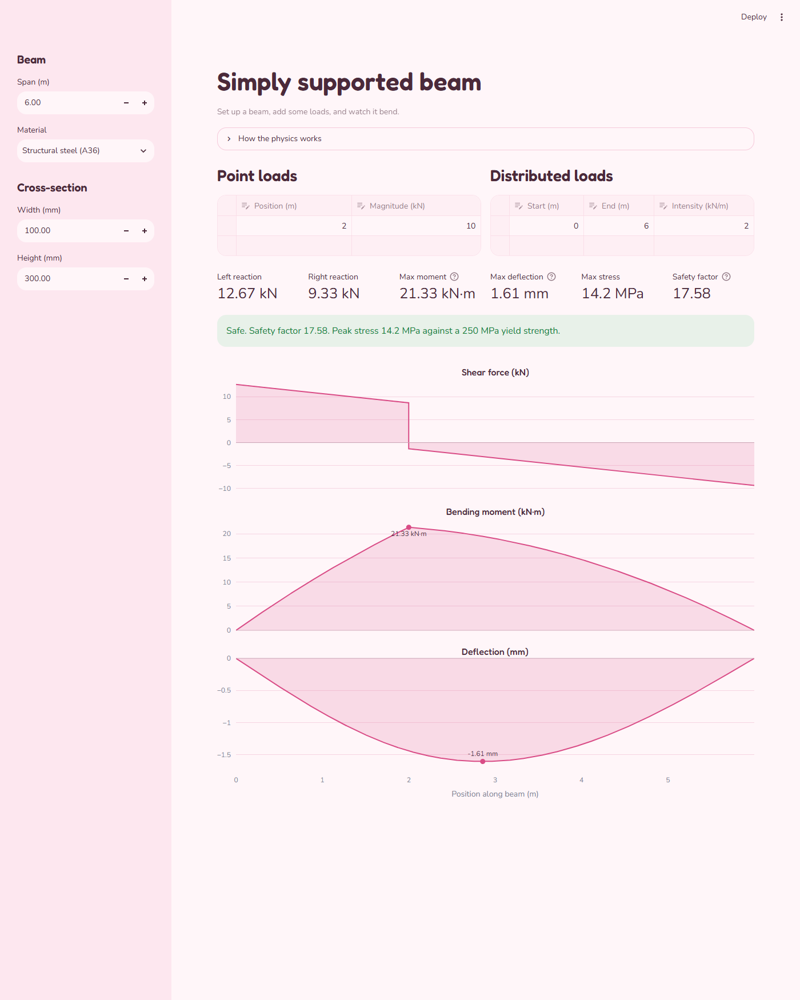

# Beam Simulator

An interactive Streamlit app that models a simply supported beam under point loads and distributed loads. Change the span, material, cross-section or loads, and the shear force, bending moment and deflection diagrams update right away. The app also reports the support reactions, peak bending stress and a safety factor.

**Live app:** [beam-sim-eyrgiqh9t64zuiahji7mxx.streamlit.app](https://beam-sim-eyrgiqh9t64zuiahji7mxx.streamlit.app/)



## Why I built it

I've always been curious about how bridges hold up the weight we put on them. The equations for shear, moment and deflection made sense on paper, but I wanted to see them change as I moved a load or swapped a material. Building this gave me a way to do that, and it was also practice in keeping the math separate from the UI and testing it against results I could check by hand.

## How to run

Requires Python 3.11 or newer.

```
git clone https://github.com/andrxmxda/beam-sim.git
cd beam-sim
python -m venv .venv
.venv\Scripts\activate        # macOS/Linux: source .venv/bin/activate
pip install -r requirements.txt -r requirements-dev.txt
streamlit run app.py
```

Run the tests with `pytest`.

## How it works

The beam has a pin at the left end and a roller at the right. All calculations use SI units. The UI converts to kN, kN/m and mm for display.

- **Reactions** come from two equilibrium equations: vertical forces sum to zero, and moments about the left support sum to zero. A distributed load is treated as its total force at its midpoint.
- **Shear and moment** are computed in closed form at each point along the beam by summing the loads to the left of that point.
- **Deflection** solves `EI y'' = M(x)` by integrating the moment twice with the trapezoid rule, then choosing the integration constants so the deflection is zero at both supports.
- **Stress** is `M c / I` for a rectangular section, and the safety factor is material strength divided by peak stress. A factor of 2 or more shows green, 1 to 2 shows yellow, and below 1 shows red.

The code is split into three files:

- `beam.py` holds the physics and has no Streamlit imports.
- `materials.py` holds the material data.
- `app.py` holds the UI.

The tests in `tests/test_beam.py` check the results against textbook formulas: midspan and off-center point loads, a full-span distributed load, and superposition. `tests/test_app.py` runs the UI headlessly using Streamlit's `AppTest`.

## Things I'd improve next

- Include the beam's own weight as a distributed load.
- Add other support types, such as cantilevers and fixed ends, and overhanging spans.
- Add I-beam and hollow sections with a section library.
- Draw a beam diagram with load arrows above the plots.
- Add a serviceability check that compares deflection with a limit such as span/360.
- Support imperial units.
